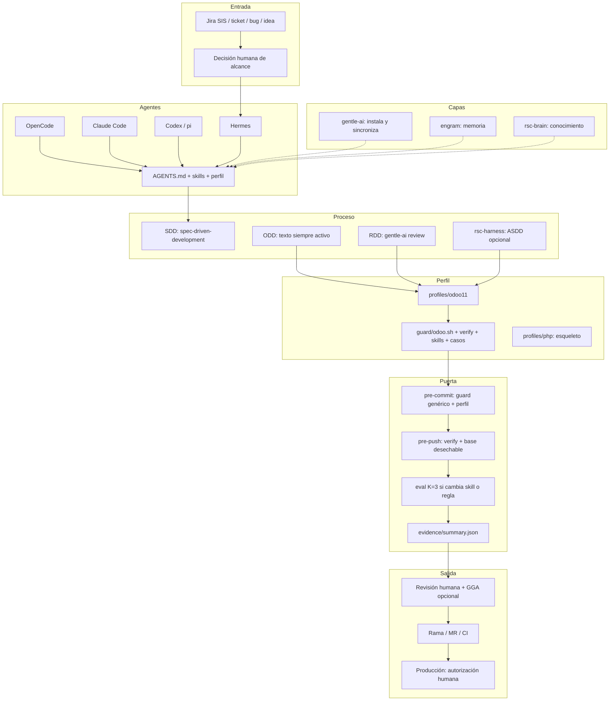

# Diagrama del sistema

El mapa visual está en `docs/diagrams/sistema.html`; se puede abrir en el navegador o
previsualizar desde el chat. Este documento deja la versión Mermaid para el repositorio.

## Flujo

## Cómo leerlo

- **Entrada**: la persona decide qué se hace y con qué prioridad.
- **Agentes**: Hermes, OpenCode, Claude, Codex y pi ejecutan el mismo flujo; lo que cambia
  es el cliente, no la puerta.
- **Proceso**: SDD es una skill; ODD es texto siempre activo; RDD es un binario; rsc-harness
  es la capa de spec/ASDD y es opcional. `gentle-ai` no sustituye a rsc-harness.
- **Perfil**: el núcleo no sabe Odoo ni PHP. Odoo 11 aporta su linter, verify, skills y
  casos; PHP es un esqueleto.
- **Puerta**: pre-commit y pre-push son los mismos hooks para todos los perfiles. La
  evaluación se ejecuta cuando cambia una skill, un prompt, una regla o una rúbrica.
- **Salida**: la revisión, el merge y el despliegue son humanos. El kit no toca producción.
- **Capas**: `gentle-ai` distribuye; `engram` recuerda; `rsc-brain` conserva conocimiento
  curado.

## Estado

| Pieza | Estado |
|---|---|
| core `guard`, `verify`, evals, hooks | implementado y probado |
| perfil Odoo 11 | extraído localmente; remoto pendiente |
| perfil PHP | esqueleto |
| `dev-agent init` y lock | pendiente |
| plantilla y generador | implementados |
| GGA | opcional, no es puerta |
| rsc-harness | opcional; no lo sustituye gentle-ai |
| producción | humano |

## Ficheros

- `docs/diagrams/sistema.html`: mapa visual con el flujo y las capas.
- `docs/CREAR-PERFIL.md`: cómo montar un perfil nuevo.
- `docs/PERFILES-EN-REPOS.md`: contrato, registro e instalación.
- `profiles/_template`: plantilla base.
