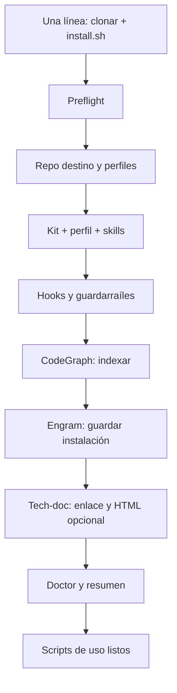

# Propuesta: instalador único de DevAgentKit

Estado: **aprobado e implementado en 3.2.0**. El instalador único (`install.sh`), el wrapper
`dev-agent` y el doctor ya existen; las piezas base (bootstrap, perfiles y tech-doc) siguen
de soporte.

## La decisión

Un compañero debe poder empezar con **una sola línea**, sin conocer flags, perfiles ni rutas.
El instalador pregunta lo mínimo, instala todo lo que se puede instalar y termina con un
diagnóstico y una lista de comandos de uso.

La línea propuesta es:

```bash
git clone https://github.com/ScalpersCompany/dev-agent-kit.git "$HOME/.dev-agent-kit" \
  && "$HOME/.dev-agent-kit/install.sh"
```

Si ya tiene el kit clonado, ejecuta `./install.sh` desde la raíz del kit. No se usa
`curl | bash`: el compañero puede leer el script antes de ejecutarlo.

## Lo que no quiero que pase

- Que tenga que editar `.dev-agent/config` a mano.
- Que tenga que saber qué perfil existe o qué flag activa cada cosa.
- Que el instalador toque producción, haga push o borre algo sin backup.
- Que meta el HTML privado de tech-doc en un repo público.
- Que un fallo de una herramienta opcional deje el kit a medias.
- Que la formación tenga que explicar diez scripts antes de la primera puerta.

## Flujo del instalador



### 0. Preflight

Comprueba, sin instalar nada todavía:

- bash, git, python3, rsync y curl;
- si el destino es un repo git y no es producción;
- si existen `codegraph`, `engram`, `gentle-ai`, los agentes y Docker (solo si se pide HTML);
- si el usuario tiene acceso a `scalpers-tech-doc` (privado).

Si falta algo imprescindible, para y dice exactamente qué falta. Si falta algo opcional
(CodeGraph, Engram, Docker, tech-doc), avisa y sigue.

### 1. Preguntas mínimas

El menú se genera leyendo `dev-agent-profiles/profiles/*/profile.json`. No hay una lista
hardcodeada: si mañana se añade un tercer perfil, aparece solo.

```text
Repo de desarrollo [detectado: /ruta/al/repo]:
Perfiles disponibles:
  1) odoo11  Odoo 11, XML, seguridad y preflight de MR
  2) php     PHP, PHPStan, PHPCS y PHPUnit (esqueleto)
  3) todos
Perfil activo si instalas varios [1]:
Agentes:
  1) Claude Code
  2) OpenCode
  3) Codex
  4) pi
  5) Hermes
  6) todos
¿CodeGraph? [S/n]
¿Engram? [S/n]
¿Tech-doc? [S/n] (repo privado)
¿Construir HTML de tech-doc? [s/N]
```

- Instalar varios perfiles no obliga a activarlos todos: se elige uno activo y los demás
  quedan disponibles.
- `--yes` acepta los valores por defecto para automatización; la interacción es el camino
  normal.
- `--target`, `--profiles`, `--active`, `--agents`, `--no-codegraph`, `--no-engram`,
  `--no-techdoc` y `--no-html` son la versión no interactiva.

### 2. Kit, perfiles y skills

El instalador reutiliza las piezas que ya existen; no las reescribe:

- `scripts/bootstrap.sh` copia el core, instala el perfil y los hooks;
- `scripts/install-techdoc.sh` clona/enlaza tech-doc y deja la referencia;
- `scripts/install-agent-adapters.sh` genera `.claude/` y `.opencode/`;
- Codex, pi y Hermes reciben las skills por copia o por `gentle-ai sync`;
- se instalan **todas** las skills del core y del perfil seleccionado, no una muestra;
- los comandos `/guard`, `/verify`, `/review`, `/eval` se copian al agente que los soporte.

Los perfiles se copian a `.dev-agent/profiles/<nombre>` y se excluye el `verify/config.env`
real del repo de perfiles. El perfil activo se escribe en `.dev-agent/config`.

### 3. Guardarraíles

Se instalan y se comprueban:

- `pre-commit` con `guard --staged`;
- `pre-push` con `verify`, cerrado hasta que haya un `TEST_CMD` real;
- `guard/guard.sh` genérico y el guard del perfil;
- `comment_lint`, `gitleaks` si está, y los checks opcionales que existan;
- `.dev-agent/`, `evidence/`, `guard-report.json` y adaptadores en `.git/info/exclude`;
- `AGENTS.md`/`CLAUDE.md` según el agente;
- `~/.agents/AGENTS.md` enlazado a tech-doc, con backup si ya existía.

Un `skipped` no se convierte en verde. El doctor final lo dice.

### 4. CodeGraph

Si está instalado:

- `codegraph init` si el repo no tiene `.codegraph/`;
- `codegraph sync` si ya existe;
- añade `.codegraph/` a `.git/info/exclude`;
- informa de ficheros y nodos indexados.

Si no está instalado, el instalador ofrece instalarlo con el gestor disponible o lo omite.
No descarga binarios sin permiso.

### 5. Engram

Si está instalado:

- crea/actualiza `.engram/config.json` con el nombre del proyecto;
- guarda una observación de instalación con `engram save`, sin secretos;
- deja el comando para futuras decisiones y bugs.

Si no está instalado, avisa: el kit funciona, pero no habrá memoria de proyecto.

### 6. Tech-doc y HTML

Con `--with-techdoc`:

- clona `ScalpersCompany/scalpers-tech-doc` si no existe;
- enlaza `~/.agents/AGENTS.md`;
- crea `docs/TECHDOC.md` con la ruta y el comando de build;
- con `--build-techdoc-html`, ejecuta `make single-html` y enlaza el HTML en
  `docs/techdoc.html`.

El HTML es privado, pesa varios MB y es un artefacto de build: **no se copia en el kit ni
se versiona**. El enlace es local y está excluido. Si no hay acceso al repo privado, el
instalador sigue y deja la referencia pendiente.

### 7. Doctor y cierre

Al final, `dev-agent doctor` comprueba:

- git, repo, perfil activo y `verify/config.env`;
- hooks, guard y verify;
- skills y adaptadores;
- CodeGraph y Engram;
- tech-doc y enlace `AGENTS.md`;
- qué está implementado y qué es opcional.

El resumen muestra qué se instaló, qué se omitió y el primer comando que debe ejecutar el
compañero.

## Scripts de uso

El instalador deja un wrapper `bin/dev-agent` (y, si puede, un enlace en
`~/.local/bin/dev-agent`). No hay que recordar rutas:

| Comando | Qué hace |
|---|---|
| `dev-agent doctor` | Diagnóstico de la instalación |
| `dev-agent guard` | Guard determinista |
| `dev-agent verify` | Verify y evidencia |
| `dev-agent review` | Revisión de diff con la skill |
| `dev-agent eval --dry-run` | Valida un caso sin gastar modelo |
| `dev-agent profile list` | Perfiles instalados |
| `dev-agent profile use odoo11` | Cambia el perfil activo |
| `dev-agent codegraph sync` | Reindexa el repo |
| `dev-agent memory save ...` | Guarda una decisión en Engram |
| `dev-agent update` | Actualiza kit, perfiles y adaptadores con backup |

Los scripts existentes siguen funcionando; el wrapper solo evita rutas y flags.

## Documentación rápida

- `docs/INSTALADOR.md`: una línea, menú, qué instala, cómo se para y cómo se recupera.
- `docs/USO-RAPIDO.md`: los comandos de cada día, en una página.
- `docs/MEJORAR-SKILLS.md`: el ciclo `correct` → editar `SKILL.md` → caso de eval →
  `--dry-run` → K=3 → docs; sin convertirlo en una puerta hasta que esté medido.
- `docs/FORMACION-DEV-AGENT-KIT.md`: la formación de tres sesiones, actualizada al
  instalador.
- `README.md`: solo el comando de una línea y el enlace a las tres guías.

## Qué instala y qué no

| Instala | No instala |
|---|---|
| Kit, perfiles elegidos, skills, comandos | Producción |
| Hooks, guard, verify, comment_lint | Secretos o tokens |
| CodeGraph indexado | Datos de cliente |
| Memoria de Engram | Push o merge automático |
| Tech-doc enlazado y HTML local | Copia del HTML privado en el repo |
| Adaptadores Claude/OpenCode/Codex/pi/Hermes | Un modelo o proveedor no aprobado |
| Documentación de uso y formación | Un daemon o servicio nuevo |

## Seguridad y recuperación

- Nada destructivo: backups `.bak-<fecha>` antes de reemplazar.
- Si falla el core, no se declara instalado.
- Si fallan CodeGraph, Engram, tech-doc o el HTML, el core sigue instalado y el doctor lo
  muestra como omitido, no como verde.
- No se ejecuta `git push`, no se toca el CI de Scalpers y no se despliega.
- El repo destino debe ser de desarrollo; el instalador rechaza `/`, `$HOME` y producción.
- Los secretos se quedan en el entorno del agente, nunca en el repo ni en la evidencia.

## Criterios de aceptación

- [ ] Un compañero ejecuta una línea y termina con el kit instalado.
- [ ] El menú muestra los perfiles reales y permite uno, varios o todos.
- [ ] Se instalan todas las skills y guardarraíles del core y del perfil elegido.
- [ ] CodeGraph indexa el repo y Engram guarda la instalación, si están disponibles.
- [ ] Tech-doc se enlaza; el HTML se enlaza en local y no se copia.
- [ ] `dev-agent doctor` distingue implementado, opcional y omitido.
- [ ] La documentación de uso y mejora de skills cabe en una página cada una.
- [ ] El instalador es idempotente y se prueba en un repo desechable.
- [ ] No hay secretos, producción, push ni borrados sin backup.

## Plan de implementación

1. `install.sh` interactivo y no interactivo, como orquestador del bootstrap actual.
2. `bin/dev-agent` con los comandos de la tabla.
3. Menú dinámico de perfiles y selección de perfil activo.
4. CodeGraph y Engram como etapas con detección y omisión segura.
5. Tech-doc y HTML con el mismo contrato actual.
6. `docs/INSTALADOR.md`, `docs/USO-RAPIDO.md`, `docs/MEJORAR-SKILLS.md` y actualización
   de README/INSTALACION/FORMACION.
7. Tests de instalación en repo desechable: interactivo simulado, `--yes`, idempotencia,
   perfil ausente, tech-doc sin acceso, codegraph/engram ausentes.
8. CI del kit con sintaxis, tests y una instalación `--yes` en un repo temporal.

## Lo que necesito aprobar

1. `install.sh` como entrada única y `bin/dev-agent` como wrapper de uso.
2. Menú dinámico de perfiles con opción “todos” y elección de perfil activo.
3. CodeGraph y Engram activados por defecto si están instalados; omitidos con aviso si no.
4. Tech-doc opcional; HTML solo con `--build-techdoc-html`; nunca copiado al repo.
5. Las tres guías rápidas y la formación actualizada.

Si se aprueba, se implementa sin tocar producción y con pruebas en un repo desechable.
